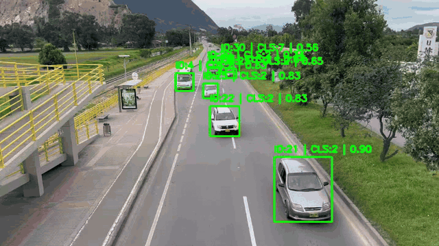
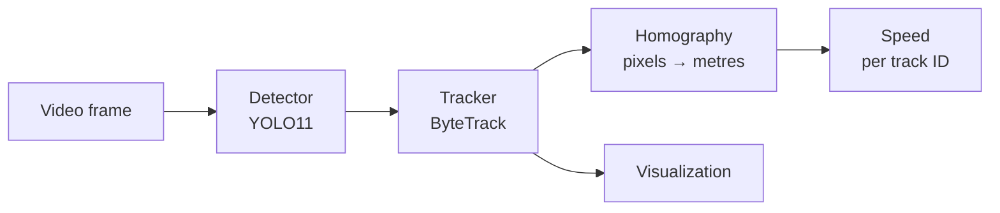

# Vehicle Speed Estimation

Detection, multi-object tracking and (in progress) speed estimation of vehicles from a fixed elevated camera, using YOLO11, ByteTrack and a ground-plane homography.

<p align="center">
  
</p>

## Status

| Stage | Status |
| :--- | :--- |
| Vehicle detection (YOLO11) | ✅ Done |
| Multi-object tracking (ByteTrack) | ✅ Done |
| Ground-plane homography (image → metres) | 🚧 Calibration module written, not yet integrated |
| Per-vehicle speed estimation | 🚧 Planned |

## Pipeline



Each stage sits behind an abstract interface (`BaseDetector`, `BaseTracker`), so a different detector (e.g. DETR) or tracker (e.g. BoT-SORT) can be swapped in without changing the pipeline. All parameters live in a YAML config file.

## Project Structure

```text
vehicle-speed-estimation/
├── configs/
│   └── pipeline.yaml          # Detector and tracker parameters
├── scripts/
│   └── main.py                # Entry point
└── src/
    ├── calibration/
    │   └── homography.py      # Image-to-ground-plane mapping
    ├── core/
    │   └── pipeline.py        # Frame loop: detect → track → draw
    ├── detection/
    │   ├── base_detector.py   # Detector interface
    │   └── yolo_detector.py   # YOLO11 implementation (Ultralytics)
    ├── tracking/
    │   ├── base_tracker.py    # Tracker interface
    │   └── byte_tracker.py    # ByteTrack implementation (supervision)
    └── visualization/
        └── visualization.py   # Bounding boxes, IDs and labels
```

## Installation

```bash
python -m venv .venv
source .venv/bin/activate      # Linux / macOS
.venv\Scripts\activate         # Windows

pip install -r requirements.txt
```

Download the YOLO11 weights from [Ultralytics](https://docs.ultralytics.com/models/yolo11/) and place them in `models/yolo/`, matching `model_path` in the config.

## Usage

```bash
# Live preview
python scripts/main.py --input data/test1.mp4 --config configs/pipeline.yaml

# Live preview + save the annotated video
python scripts/main.py --input data/test1.mp4 --output data/output.mp4
```

Press `Esc` to stop. With `--output`, the annotated video is written at the input's frame rate (`mp4v` codec); stopping early keeps the frames processed so far.

## Configuration

`configs/pipeline.yaml`:

| Parameter | Description |
| :--- | :--- |
| `detector.model_path` | Path to the YOLO11 weights |
| `detector.conf` | Minimum detection confidence |
| `detector.img_size` | Inference image size |
| `detector.allowed_classes` | COCO class IDs to keep: 2 car, 3 motorcycle, 5 bus, 7 truck |
| `tracker.track_activation_threshold` | Minimum confidence to start a new track |
| `tracker.lost_track_buffer` | Frames a lost track is kept before its ID is dropped |
| `tracker.minimum_matching_threshold` | Matching threshold for associating detections with tracks |
| `tracker.frame_rate` | Video frame rate used by the tracker |

## How Speed Will Be Estimated

1. **Calibration:** select points on the road surface with known real-world distances (e.g. lane markings) and compute a homography from image pixels to ground-plane metres.
2. **Ground contact point:** for each tracked vehicle, take the bottom-centre of its bounding box, which lies on the road plane.
3. **Speed:** project that point to metres every frame and divide the distance travelled by the elapsed time, using the video's real frame rate.

## Roadmap

- [ ] Integrate the homography into the pipeline
- [ ] Per-track speed estimation with temporal smoothing
- [x] Save annotated output video
- [ ] Record a stabilized aerial video with a drone for a cleaner evaluation
- [ ] Validate speed estimates against a reference measurement

## Tech Stack

Python · PyTorch · Ultralytics YOLO11 · supervision (ByteTrack) · OpenCV · NumPy · PyYAML